# Serverless Expense Tracker on AWS

A login-protected expense tracker built entirely on serverless AWS services, with an AI feature that gives spending advice. It runs on pay-per-use pricing, so an idle deployment costs close to nothing.

**Live demo:** https://d18r0likirjff2.cloudfront.net
(May be offline if the AWS free plan has ended. See the [screenshots](#screenshots) and the [redeploy guide](#keeping-this-project-ready-if-the-aws-account-expires).)

**Demo video:** [Watch the walkthrough](docs/demo.mp4)

## What it does

- Sign up with email verification, sign in, and sign out (Amazon Cognito)
- Add, list, update and delete expenses (each user sees only their own data)
- Filter by month, with a monthly total in rupees
- Percentage breakdown of spending by category for the selected month
- **Get AI insights**: tips on where to cut back and cheaper alternatives, written by Amazon Bedrock (Nova Micro)

## Architecture

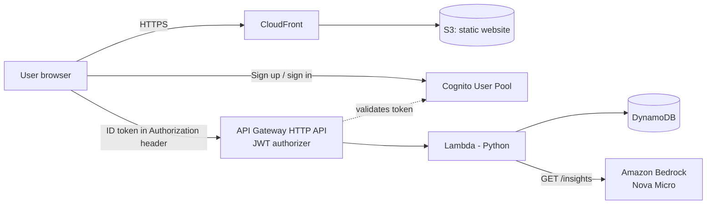

**Request flow:** the browser signs in with Cognito and receives a token. Every API call sends that token. API Gateway checks it with a JWT authorizer before Lambda runs. Lambda reads the user ID from the verified token and reads or writes only that user's items in DynamoDB.

## Tech stack

| Layer | Service |
|---|---|
| Frontend | HTML, CSS and JavaScript, hosted on S3 behind CloudFront (private bucket, access via CloudFront) |
| Authentication | Amazon Cognito user pool (email sign-in, app client with no secret) |
| API | API Gateway HTTP API with a JWT authorizer and throttling |
| Backend | AWS Lambda (Python) |
| Database | DynamoDB (on-demand capacity) |
| AI | Amazon Bedrock, Nova Micro through an inference profile |
| Access control | IAM roles with least-privilege inline policies |

## API

| Method and path | Purpose | Login required |
|---|---|---|
| `POST /expenses` | Add an expense | Yes |
| `GET /expenses?month=YYYY-MM` | List expenses and the monthly total | Yes |
| `PUT /expenses` | Update amount, category or description | Yes |
| `DELETE /expenses?expense_sk=...` | Delete an expense | Yes |
| `GET /insights?month=YYYY-MM` | Category breakdown and AI tips | Yes |
| `OPTIONS /expenses`, `OPTIONS /insights` | Browser CORS preflight | No |

## Design decisions

- **DynamoDB key design:** partition key `user_id` (the Cognito user ID) and sort key `expense_sk` (`date#unique-id`). Expenses come back sorted by date, and one month is fetched with a single `begins_with` query, with no table scans.
- **Security:** the JWT authorizer rejects unauthenticated requests at API Gateway, before Lambda runs. The Lambda IAM role can only touch the one table and the one Bedrock model it needs. The S3 bucket is private.
- **AI that cannot do the math wrong:** Lambda calculates the totals and percentages in code. The model only receives those finished numbers and writes the advice. During testing, the model made mistakes when asked to compare numbers itself, so the calculation was moved out of the prompt.
- **Graceful failure:** if the Bedrock call fails, the endpoint still returns the category breakdown and the page still shows the bars.
- **Input handling:** amounts are stored as exact decimals, categories sent to the AI are restricted to a fixed list, and the page builds its output with `textContent` instead of inserting raw HTML.
- **Cost control:** DynamoDB on-demand, API throttling, a budget alert, and a small, cheap model for the AI feature.

## Problems solved along the way

- **CORS with an auth header:** the browser blocked requests until the `authorization` header was allowed in the CORS response.
- **Preflight per route:** every path (`/expenses` and `/insights`) needs its own unauthenticated `OPTIONS` route, or the browser blocks the call before it is sent.
- **Authorizer 401s look like CORS errors:** a rejection from API Gateway carries no CORS headers, so the browser reports it as a CORS failure. The page checks token expiry before each call to show a clear message instead.

## Repository contents

```
serverless-expense-tracker/
├── README.md
├── lambda_function.py            # Lambda backend (CRUD, CORS preflight, AI insights)
├── index.html                    # Single-page frontend
├── iam-policies/
│   ├── expense-table-access.json
│   └── bedrock-insights-access.json
└── docs/
    ├── demo.mp4                  # Screen recording of the working app
    └── screenshots/              # Evidence of the working deployment
```

| File | Description |
|---|---|
| `lambda_function.py` | Lambda backend: expense CRUD, CORS preflight and the AI insights endpoint |
| `index.html` | Single-page frontend: sign in or up, expense list, category bars and AI insights |
| `iam-policies/` | The two inline IAM policies attached to the Lambda role. Replace `YOUR_ACCOUNT_ID` with your own account number |

## How to deploy

Everything below was built by hand in the AWS console, in region **Asia Pacific (Mumbai) `ap-south-1`**. Rebuilding it takes roughly one to two hours. Set a budget alert (for example $5) before you start.

1. **DynamoDB:** create a table named `ExpenseTracker` with partition key `user_id` (String), sort key `expense_sk` (String) and on-demand capacity.
2. **Lambda:** create a function named `ExpenseHandler` (Python 3.12 or newer) and paste in `lambda_function.py`. Set the timeout to 15 seconds.
3. **IAM:** open the Lambda's execution role and add both policies from `iam-policies/` as inline policies, after replacing `YOUR_ACCOUNT_ID`.
4. **Cognito:** create a user pool with email sign-in and self-registration enabled. Create an app client of type single-page application (no client secret) and enable the `ALLOW_USER_PASSWORD_AUTH` flow. Note the User pool ID and the App client ID.
5. **API Gateway:** create an HTTP API named `ExpenseTrackerAPI` with the Lambda as the integration. Add these routes, all pointing to the Lambda: `POST /expenses`, `GET /expenses`, `PUT /expenses`, `DELETE /expenses`, `GET /insights`, `OPTIONS /expenses`, `OPTIONS /insights`.
6. **JWT authorizer:** create an authorizer with identity source `$request.header.Authorization`, issuer `https://cognito-idp.ap-south-1.amazonaws.com/<USER_POOL_ID>` and audience `<APP_CLIENT_ID>`. Attach it to every route **except** the two `OPTIONS` routes. Leave the API's built-in CORS setting empty, because the Lambda returns the CORS headers itself. Set throttling on the `$default` stage (for example rate 5, burst 10).
7. **Bedrock:** confirm that the **APAC Nova Micro** inference profile is available (`apac.amazon.nova-micro-v1:0`).
8. **Frontend:** in `index.html`, set `API` to your API Gateway address and `CLIENT_ID` to your app client ID. Create a private S3 bucket and upload `index.html`. Create a CloudFront distribution with the bucket as its origin, private access to the bucket turned on, and `index.html` as the default root object. Apply the bucket policy that CloudFront offers.
9. **Test:** open the CloudFront address, create an account, confirm the email code, sign in, add expenses and click **Get AI insights**.

If you change `index.html` later, upload it to S3 again and create a CloudFront invalidation for `/*`.

## Screenshots

| | |
|---|---|
| 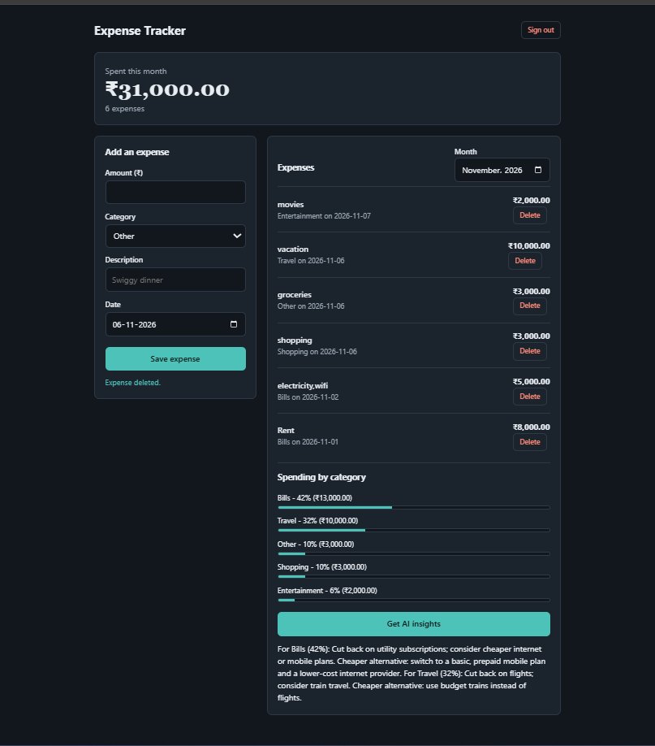 | 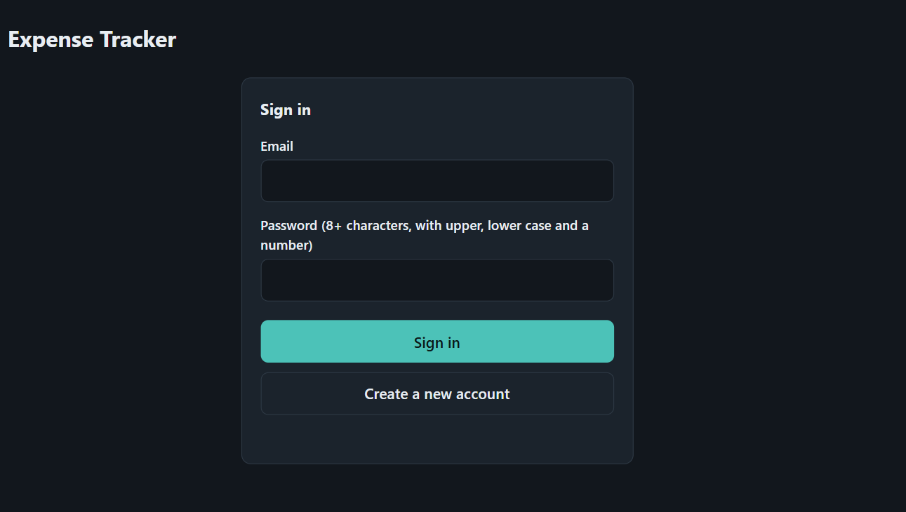 |
| Signed-in app with expenses, category bars and AI tips | Sign-in and sign-up screen |
| 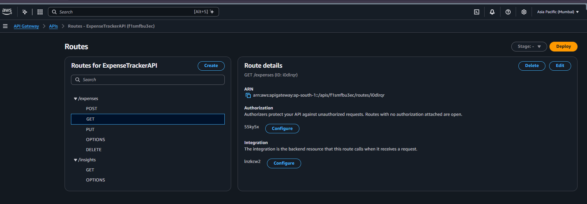 | 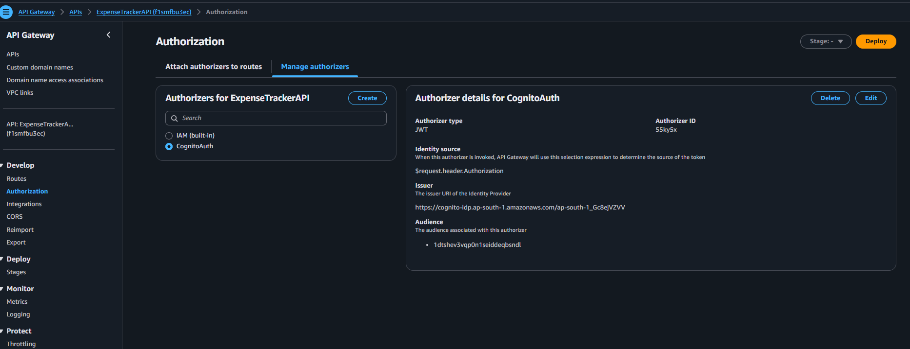 |
| API Gateway routes | JWT authorizer attached to the routes |
| 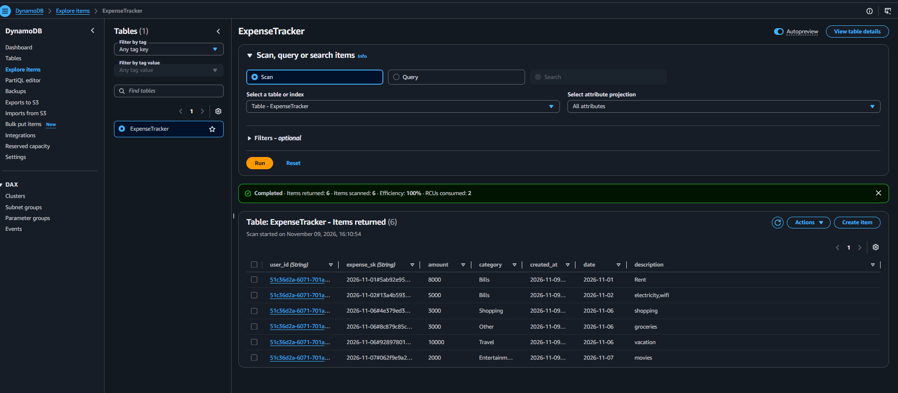 | 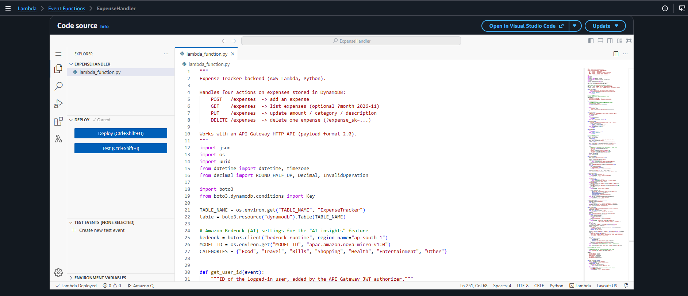 |
| DynamoDB items for the signed-in users | Lambda function code |
| 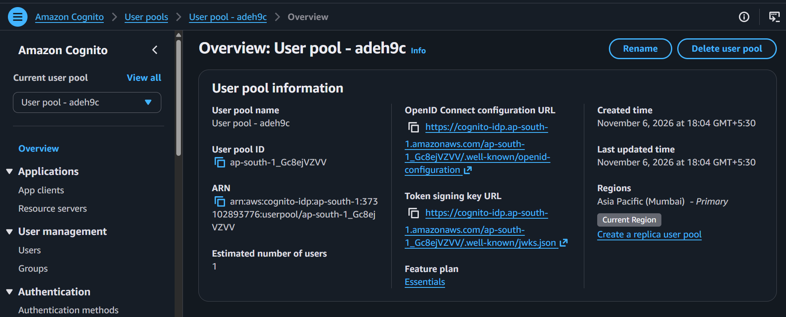 | 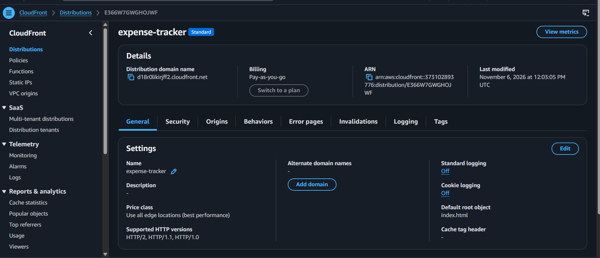 |
| Cognito user pool | CloudFront distribution serving the site |
|  |  |
| Private S3 bucket holding the website file | Least-privilege inline policies on the Lambda role |
| 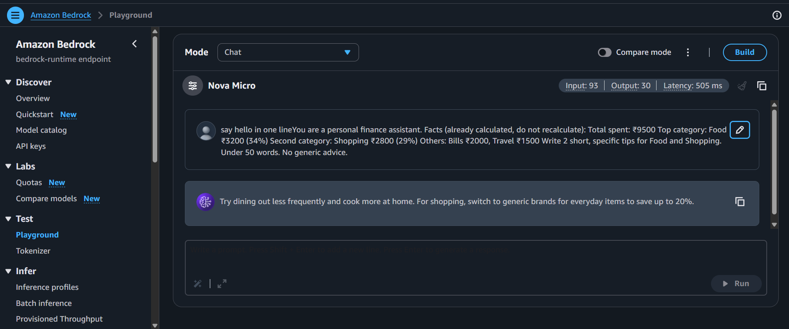 | 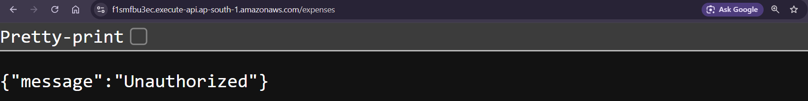 |
| Testing Nova Micro (a text-only model) in the Bedrock playground before wiring it into Lambda | The API refuses a request that has no login |

## Keeping this project ready if the AWS account expires

This project was built on an AWS free-tier account, and the account or its free plan may end. The repository is meant to be enough to show the project and to rebuild it later:

- **To show it to someone:** the screenshots above, the architecture diagram, and the demo video (if added in `docs/`) show it working.
- **To rebuild it:** the code, the IAM policies and the deploy steps are all here. Rebuilding is mostly clicking through the console and takes one to two hours.
- **What is not stored here:** your account ID (policies use `YOUR_ACCOUNT_ID`), the live URLs, and any user data. The API address and Cognito app client ID in `index.html` belong to the old deployment, so replace them with new values.
- **To avoid charges when you stop using it:** delete the CloudFront distribution (disable it first), the S3 bucket, the API, the Lambda function, the Cognito user pool and the DynamoDB table, and check the Billing page afterwards.

## Possible next steps

- Monthly summary email per user with EventBridge, Lambda and Amazon SES (SES starts in a sandbox that only sends to verified addresses until production access is granted)
- Receipt scanning: upload a receipt photo and extract the amount, date and shop with a multimodal Bedrock model that accepts images (for example Nova Lite). Amazon Textract is an alternative, but it was not available on the basic free account plan used for this project
- Infrastructure as code (SAM or Terraform)
- Restrict CORS to the CloudFront domain and add a custom domain
- Let the AI see expense descriptions for more specific tips

## Cost

Lambda, API Gateway, DynamoDB, Cognito, S3 and CloudFront stay within or near free allowances at demo traffic. Bedrock is billed per use and costs a fraction of a rupee for a small number of insight requests.
